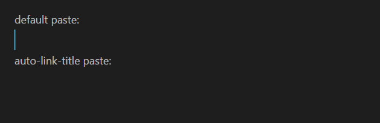

## Obsidian Auto Link Title

### Automatically Title New Links & Show Favicons
This plugin automatically fetches the webpage to extract link titles when they're pasted, creating a markdown link with the correct title set. Optionally, it can also fetch and display the website's favicon next to the link (in preview mode).

#### For example:

When pasting `https://github.com/zolrath/obsidian-auto-link-title` the plugin fetches the page and retrieves the title, resulting in a paste of:

`[zolrath/obsidian-auto-link-title: Automatically fetch the titles of pasted links](https://github.com/zolrath/obsidian-auto-link-title)`

If favicon fetching is enabled, the link will be displayed with the site's favicon before the title (in preview mode):

` [zolrath/obsidian-auto-link-title: ...](...)`

### Add Titles To Existing Raw URLs
Use `ctrl-shift-e` (Windows) or `cmd-shift-e` (OS X) to enhance an existing raw link to a markdown formatted link with the proper title (and favicon, if enabled).

If your text cursor is within the url `https://github.com/zolrath/obsidian-auto-link-title`, pressing `ctrl-shift-e` or `cmd-shift-e` converts the text to `[zolrath/obsidian-auto-link-title: ...](https://github.com/zolrath/obsidian-auto-link-title)` (with favicon if enabled).

### Overwrite Titles Of Existing Markdown Links
You can also use `ctrl-shift-e` (Windows) or `cmd-shift-e` (OS X) to overwrite an existing title of a markdown link with the fetched title (and favicon, if enabled).

If your text cursor is within `[some plugin](https://github.com/zolrath/obsidian-auto-link-title)`, pressing `ctrl+shift+e` fetches the site's title and replaces it, resulting in `[zolrath/obsidian-auto-link-title: ...](https://github.com/zolrath/obsidian-auto-link-title)` (with favicon if enabled).

### Favicon Support Details

- Favicon fetching is implemented in a new utility and is enabled by default (can be disabled in the plugin settings).
- The plugin tries to fetch the favicon directly from the site, and falls back to a public favicon service if needed.
- Favicons are displayed as HTML `` tags before the link title (in preview mode only).
- Both title and favicon are fetched concurrently for speed.
- You can disable favicon fetching in the plugin settings if you prefer not to display them or want to avoid extra network requests.

### Settings

- **Enable Favicon Fetching**: Toggle to show or hide favicons next to links.
- **Enhance Default Paste**: Fetch the link title (and favicon) when pasting a link in the editor.
- **Enhance Drop Events**: Fetch the link title (and favicon) when dragging and dropping a link.
- **Maximum title length**: Set a maximum length for fetched titles.
- **Preserve selection as title**: Use selected text as the link title instead of the fetched title.
- **Website Blacklist**: Prevent title/favicons from being fetched for certain sites.
- **Use New Scraper**: Use the experimental new title scraper (desktop only by default).
- **Use Better Fetching Placeholder**: Use a more readable placeholder while fetching.
- **LinkPreview API Key**: Optionally use the LinkPreview.net service for fetching titles.

### Mobile Pasting
To paste a URL, perform the `Tap and Hold -> Paste` action in your document.

#### Gboard
Google's [Gboard](https://play.google.com/store/apps/details?id=com.google.android.inputmethod.latin&hl=en_US&gl=US) keyboard has a Clipboard helper shortcut above the keyboard to quickly paste. Due to the implementation of that feature, it does not trigger the `paste` event, preventing this plugin from interacting with the text.

---

#### Special Thanks

Favicon support in this plugin was inspired by and borrows ideas from [obsidian-link-favicon](https://github.com/joethei/obsidian-link-favicon) plugin by [joethei](https://github.com/joethei). Thank you!
